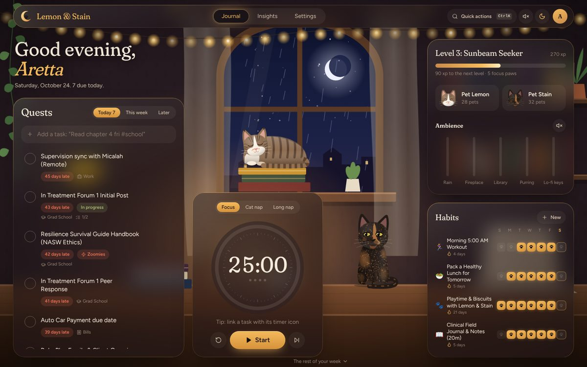
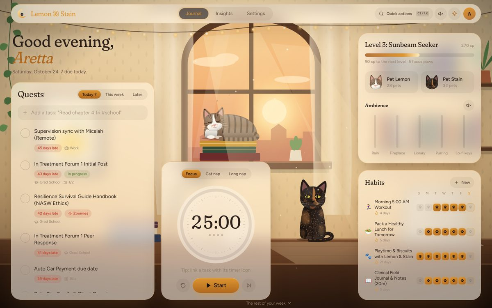
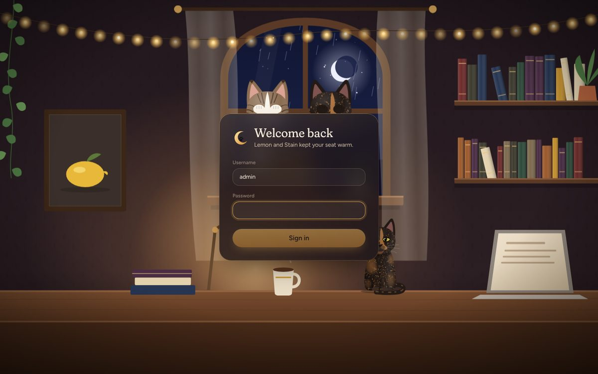
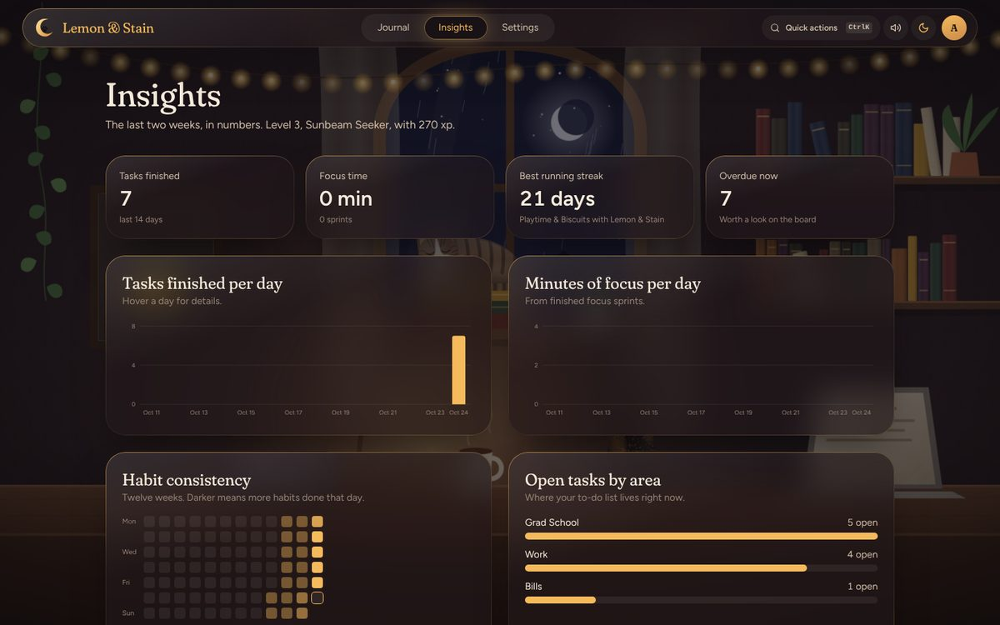

# Lemon & Stain

A cozy study dashboard for tasks, focus sprints, habits and coursework, set in an
illustrated study room where Lemon and Stain keep you company. The room follows
the time of day: late-afternoon sun in **Lemon Sunlight**, lamp light and rain in
**Stain Nocturne**.



| Lemon Sunlight | Sign-in | Insights |
|---|---|---|
|  |  |  |

## What's inside

- **Quests**: today, this week and later lists; natural-language quick add
  (`Read chapter 4 fri !high #school` sets the date, priority and area); steps
  (subtasks); notes; undo for completes and deletes.
- **The board**: drag tasks between Up next, In paws and Done.
- **Focus timer**: survives refreshes, links to a task, logs every finished
  sprint, and runs every fourth break long.
- **Habits** with real date-based streaks, plus a twelve-week heatmap in Insights.
- **Calendar**, **coursework tracker**, autosaving **field notes**, and a **launchpad** of links.
- **Google Sheet sync** and CSV import/export.
- **Lemon and Stain**: drawn from photos, they nap, blink, watch your cursor,
  purr when petted, trot across the page as you scroll, and parade when you
  finish everything due today or level up.
- **Delight**: confetti, combos, a synthesized sound engine and an ambience mixer
  (rain, fireplace, library hush, purring, lo-fi keys). No audio files.
- **Quick actions** (`Ctrl/⌘ K`) and keyboard shortcuts (`N`, `F`, `L`, `1`–`3`).
- **Calm mode** for a still room, and it respects the device's reduced-motion setting.

## Security

Everything sits behind a sign-in. There is one account, created on first start
from `ADMIN_USERNAME` / `ADMIN_PASSWORD`.

- Passwords are hashed with scrypt. Sessions are random tokens in an `HttpOnly`,
  `Secure`, `SameSite=Strict` cookie, and only a hash of each token is stored.
- Failed sign-ins are throttled (5 per 15 minutes per IP).
- State-changing requests must carry a custom header, which blocks cross-site
  request forgery.
- The API docs (`/docs`) are only served in development.
- Caddy adds HTTPS with HSTS, a strict Content-Security-Policy and the usual
  hardening headers.

> **Keep client information out.** This is a personal productivity tool, not a
> clinical record system. Don't store client names or identifying details in tasks or notes.

## Run it locally

**Without Docker** (two terminals):

```bash
# API: http://localhost:8000
cd backend
python -m venv venv && source venv/bin/activate   # Windows: venv\Scripts\activate
pip install -r requirements-dev.txt
APP_ENV=development uvicorn main:app --reload --port 8000

# Web: http://localhost:5173
cd frontend
npm install
npm run dev
```

In development a throwaway account is created automatically: **admin / lemon-and-stain**.
On Windows, double-click `start-local.bat`: it installs everything on first run, starts both servers in their own windows, and opens the dashboard once it is ready (needs Python 3.10+ and Node.js 20+).

**With Docker** (production-like, HTTPS on https://localhost):

```bash
cp .env.example .env          # set ADMIN_PASSWORD (10+ characters) and DOMAIN=localhost
docker compose up -d --build
```

**Tests**

```bash
cd backend && python -m pytest                          # 30 API tests
cd frontend && npm run typecheck && npm test && npm run build
```

## Deploy to the Hostinger VPS

Every push to `main` runs the tests, builds both Docker images in GitHub Actions,
pushes them to GitHub Container Registry, and rolls them out on the VPS. The VPS
never compiles anything, so a 1 GB plan is plenty. Each deploy backs up the
database first. If the new version doesn't come up healthy, the deploy rolls back
to the last good release automatically and the GitHub job fails.

### One-time setup

1. **Make a deploy key** on your computer:
   ```bash
   ssh-keygen -t ed25519 -f lemon-stain-deploy -N "" -C "github-deploy"
   ```
2. **Prepare the server.** Copy `scripts/bootstrap-vps.sh` to the VPS and run it
   as root with the *public* key:
   ```bash
   scp scripts/bootstrap-vps.sh root@YOUR_VPS_IP:
   ssh root@YOUR_VPS_IP 'bash bootstrap-vps.sh "$(cat)"' < lemon-stain-deploy.pub
   ```
   It installs Docker, turns on the firewall (SSH, 80, 443), fail2ban and
   automatic security updates, adds a 1 GB swap file, creates a `deploy` user, and
   schedules a nightly database backup.
3. **Point DNS.** Add an `A` record for your domain (for example
   `dashboard.yourdomain.com`) that points at the VPS IP.
4. **Create the server's `.env`** in `/opt/lemon-stain/.env` (start from
   `.env.example`): set `DOMAIN`, `ADMIN_USERNAME`, `ADMIN_PASSWORD` and
   `DISPLAY_NAME`. Then lock it down with `chmod 600 /opt/lemon-stain/.env`.
5. **Add the GitHub secrets** under *Settings → Secrets and variables → Actions*:

   | Secret | Value |
   |---|---|
   | `VPS_HOST` | the VPS IP or hostname |
   | `VPS_SSH_KEY` | the full contents of the *private* key `lemon-stain-deploy` |
   | `VPS_KNOWN_HOSTS` | output of `ssh-keyscan -t ed25519 YOUR_VPS_IP` (check the fingerprint against the Hostinger panel) |
   | `VPS_USER` | optional, defaults to `deploy` |
   | `VPS_PORT` | optional, defaults to `22` |

   Optionally add a GitHub **environment** named `production` with required
   reviewers if you'd like to approve each deploy.
6. **Push to `main`** (or run *Deploy to VPS* from the Actions tab). The first
   start creates your account, and Caddy fetches the HTTPS certificate.

### Day to day

All of these run in `/opt/lemon-stain` on the VPS:

| Task | Command |
|---|---|
| See what's running | `docker compose ps` |
| Logs | `docker compose logs -f --tail=100` |
| Back up now | `./scripts/backup.sh` (nightly at 03:15, kept 14 days in `backups/`) |
| Restore a backup | `./scripts/restore.sh backups/dashboard-<stamp>.db` |
| Roll back by hand | `SKIP_PULL=1 ./scripts/deploy.sh <older sha-tag>` |
| Reset the password | `docker compose exec api python manage.py set-password <username>` |
| Sign out every device | `docker compose exec api python manage.py sign-out-everywhere` |

Copy `backups/` off the server now and then (or sync it to cloud storage).

## How it's built

```
backend/     FastAPI + SQLAlchemy + SQLite (WAL). Auth in security.py, idempotent
             migrations in database/migrations.py, tests in tests/.
frontend/    React 18 + TypeScript + Vite + Tailwind, Framer Motion, Zustand,
             dnd-kit, Lenis. The illustrations are hand-built SVG in src/art/.
             Caddyfile + Dockerfile build the web image (static files + reverse proxy).
scripts/     bootstrap-vps.sh, deploy.sh (health-checked, auto-rollback),
             backup.sh, restore.sh.
.github/     ci.yml (tests + image builds on PRs), deploy.yml (main → GHCR → VPS).
```

**About the art.** Lemon and Stain are SVG illustrations coded from reference
photos. The trotting cat is a two-segment leg rig posed every frame from a
trot gait. Diagonal leg pairs move together, and when scrolling drives the
cat, its stride is computed from the distance travelled so the paws stay planted.
Tools like Rive or Lottie need hand-animated files made in their editors.
Procedural SVG keeps the cats editable in code, light (no runtime or asset
downloads), and able to react to the app: they watch the cursor, wake when
petted, and celebrate with you.

## License

MIT. Made with love for Lemon 🍋 and Stain 🐾.
